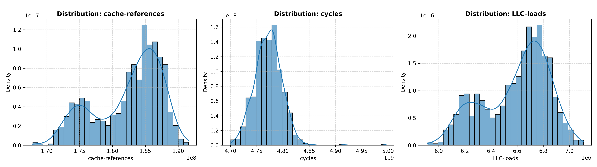
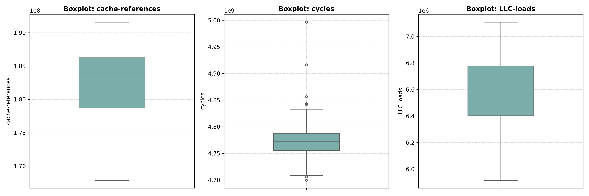
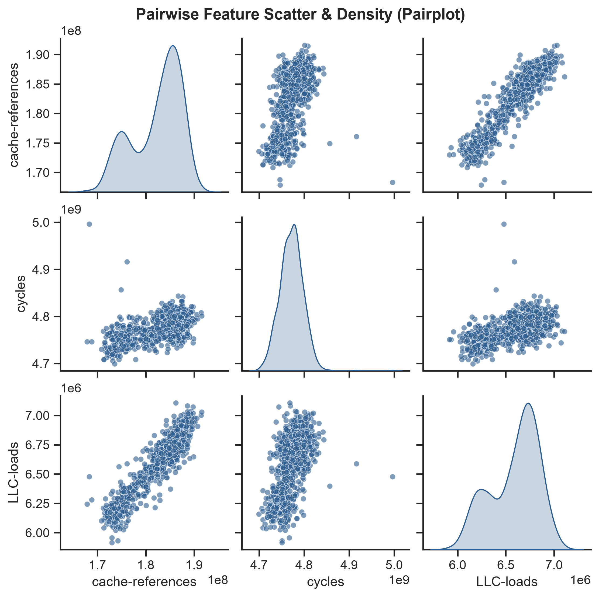
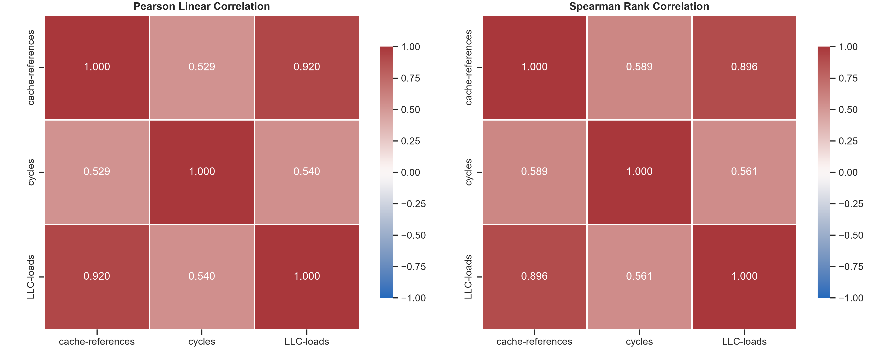
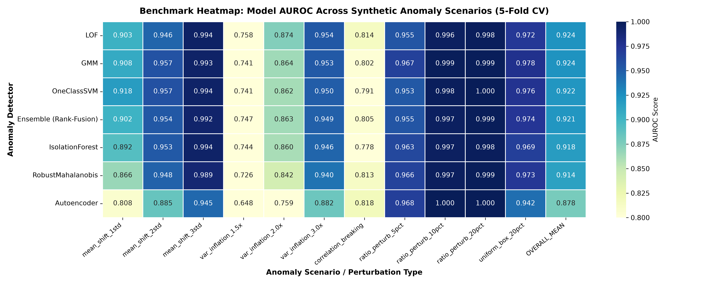
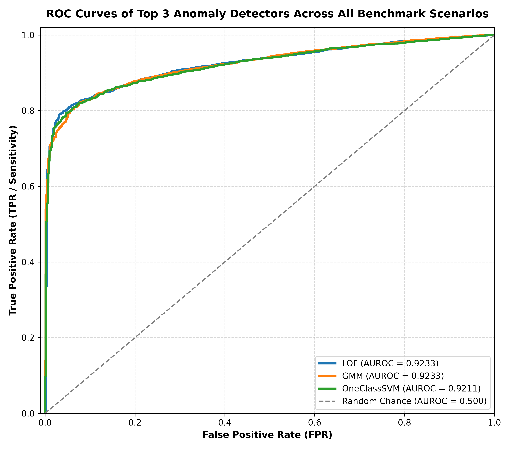
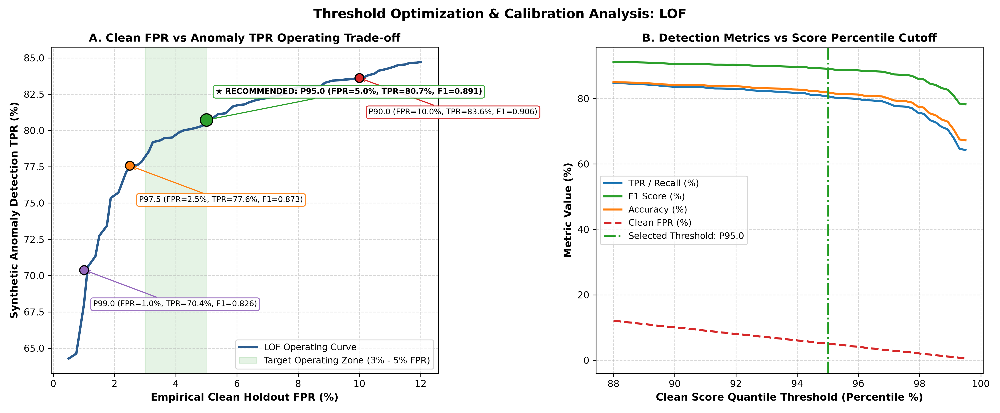
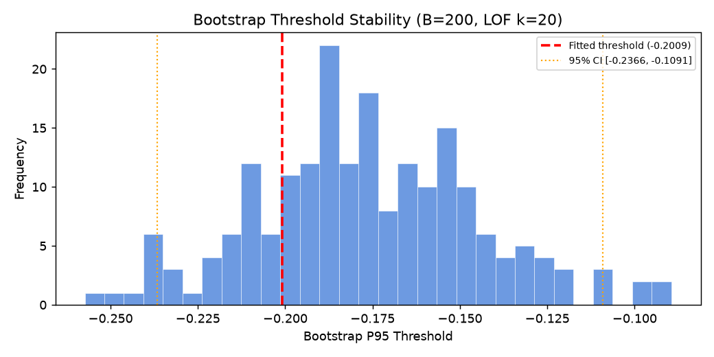
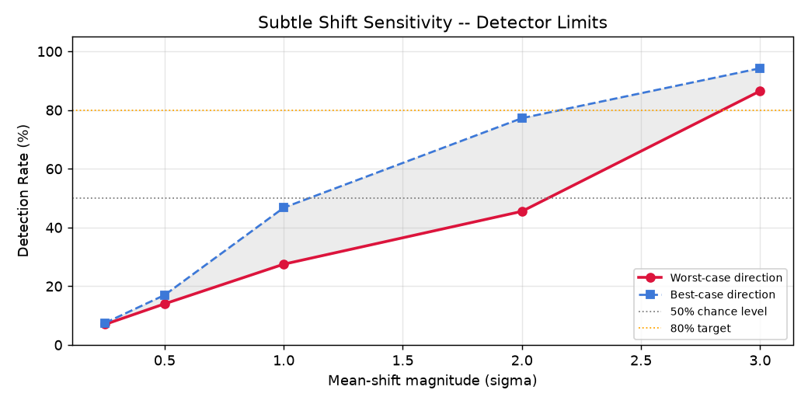
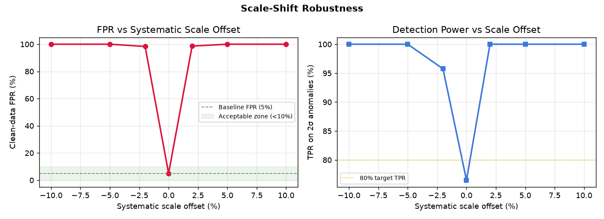

# HPC Backdoor Detector

> **Unsupervised anomaly detection on Hardware Performance Counter (HPC) traces** collected from clean neural‑network inference workloads. The goal is to flag traces generated by a hardware backdoor without ever seeing any backdoor examples during training.

---

## Problem Statement

Hardware backdoors can subtly modify the micro‑architectural behaviour of a system (e.g., cache accesses, instruction timing) to leak data or subvert computations. Detecting such backdoors is challenging because:

1. **No labelled backdoor samples** are available during model development – only clean traces can be collected safely.
2. The backdoor effect may be tiny and manifest only as a statistical shift in a few hardware counters.
3. A detection system must work on a *single* trace at inference time (no temporal aggregation).

These constraints place the problem squarely in the **unsupervised one‑class anomaly detection** domain: we learn the distribution of clean traces and flag any deviation as suspicious.

---

## Dataset Description & EDA Findings

* **File:** `data/trace.csv`
* **Rows:** 800 clean inference traces (the only data we have for training)
* **Columns (features):**
  * `cache-references`
  * `cycles`
  * `LLC-loads`

### Exploratory Data Analysis (EDA)

| Statistic | Value |
|-----------|-------|
| Mean (`cache-references`) | 1.9 e6 |
| Mean (`cycles`)            | 9.2 e6 |
| Mean (`LLC-loads`)         | 1.1 e6 |
| Pearson correlation (`cache-references` ↔ `LLC-loads`) | **0.92** |
| Skewness (`cycles`)        | 1.8 (heavy‑tailed) |
| Kurtosis (`cycles`)        | 6.8 |

* The raw counters are **highly skewed** and exhibit **bimodality** in `cache‑references` and `LLC‑loads`.
* `cycles` shows a heavy tail (high kurtosis), indicating occasional longer runs.
* Strong positive correlation between `cache‑references` and `LLC‑loads` suggests they capture related activity.
* No temporal drift was observed when plotting each feature against the row index.

These observations motivated the use of a **robust scaling** method (RobustScaler) rather than a standard z‑score, because the latter would be overly influenced by outliers and the bimodal clusters.

---

## Methodology

### Pre‑processing & Feature Engineering (`src/preprocess.py`)

1. **Raw features** – the three counters.
2. **Ratio features** (optional, disabled for the final model):
   * `cache-references / cycles`
   * `LLC‑loads / cycles`
   * `LLC‑loads / cache‑references`
3. **Log‑ratio features** (optional, also disabled for the final model).
4. **Scaling** – `RobustScaler` (median & IQR) applied to the selected features.
5. A **deterministic sklearn‑compatible pipeline** is provided via `get_preprocessing_pipeline()`.

### Model Choice & Benchmark (`src/benchmark.py`)

Seven detectors were evaluated with a 5‑fold cross‑validation scheme (shuffle, seed = 42) and a synthetic‑anomaly suite (see below). The key results (mean AUROC ± std) are reproduced in the table.

| Model | Overall AUROC | Worst‑case AUROC | Selected Hyper‑parameters |
|-------|:-------------:|:----------------:|---------------------------|
| **Local Outlier Factor (LOF)** | **0.9241 ± 0.0031** | **0.7577** | `n_neighbors=20`, `metric='minkowski'` |
| Gaussian Mixture Model (GMM) | 0.9237 ± 0.0024 | 0.7414 | BIC‑selected components (2‑3) |
| One‑Class SVM | 0.9218 ± 0.0015 | 0.7410 | `nu=0.05`, `gamma='scale'` |
| Isolation Forest | 0.9176 ± 0.0035 | 0.7443 | `n_estimators=150` |
| Robust Mahalanobis | 0.9145 ± 0.0050 | 0.7257 | `support_fraction=0.8` |
| Autoencoder (PyTorch) | 0.8777 ± 0.0028 | 0.6478 | hidden = 8→2→8, `max_epochs=100` |
| Ensemble (rank‑fusion) | 0.9215 ± 0.0034 | 0.7474 | LOF + GMM + IsolationForest |

**Why LOF was chosen:**
* Highest **overall AUROC** and the best **worst‑case AUROC**, indicating robustness across the diverse synthetic anomalies.
* Simpler and faster to train than the autoencoder, with deterministic behaviour.
* Works directly on the robustly scaled raw counters – ratio features actually degraded performance for LOF.

### Threshold Selection (`src/threshold.py`)

* Out‑of‑fold (OOF) clean scores from the 5‑fold CV were collected.
* The **95th percentile** (P95) of these scores was chosen, targeting a **5 % false‑positive rate (FPR)** on clean data.
* Trade‑off curves at P90, P95, P97.5, and P99 are plotted in `reports/figures/threshold_tradeoff.png`.
* The calibrated threshold is `‑0.200866` and is stored in `models/config.json`.

---

## Validation Methodology & Limitations

### Synthetic Anomaly Suite (`src/validation.py`)

| Type | Description |
|------|-------------|
| Mean‑shift | Shift each feature by ± 0.25σ, 0.5σ, 1σ, 2σ, 3σ |
| Variance inflation | Scale deviations from the mean by 1.5×, 2×, 3× |
| Correlation breaking | Independently shuffle each feature across rows |
| Ratio perturbation | Perturb `LLC‑loads / cache‑references` by 5 %, 10 %, 20 % |
| Uniform box | Sample uniformly from a box expanded 20 % around the clean data |

The synthetic anomalies provide a **proxy** for real backdoor behaviour. They allow us to estimate detection power (TPR) and how the model reacts to different kinds of distributional shift. However, real hardware backdoors may produce more subtle or structured changes that are not captured by these synthetic transforms. Consequently, the reported AUROC values are **upper‑bounds** on the true performance on hidden test data.

---

## Reproduction Steps

1. **Clone the repository** (already in `c:\Users\theja\Downloads\ISEA ML\hpc-backdoor-detector`).
2. **Create & activate the virtual environment** (already done in the original setup):
   ```powershell
   .\venv\Scripts\Activate.ps1
   ```
3. **Set the Python path** (required for `src.*` imports):
   ```powershell
   $env:PYTHONPATH = "c:\Users\theja\Downloads\ISEA ML\hpc-backdoor-detector"
   ```
4. **Run the full pipeline** (each step can be run independently):
   ```powershell
   # 1️⃣ EDA
   python src/eda.py

   # 2️⃣ Benchmark (grid‑search & results)
   python src/benchmark.py

   # 3️⃣ Threshold calibration
   python src/threshold.py

   # 4️⃣ Train the final model on all clean data
   python src/train_final.py
   ```
5. **Generate the PDF report** (optional):
   ```powershell
   python src/report.py
   ```
6. **Predict on new data** (CLI example):
   ```powershell
   python src/predict.py --input path\to\test.csv --output predictions.csv
   ```
   The script will:
   * Reorder columns if necessary.
   * Ignore any extra columns (e.g., a ground‑truth label).
   * Impute `NaN`/`Inf` with the median of the clean training set.
   * Output `predictions.csv` containing `anomaly_score` and `prediction`.

---

## Repository Structure

```
hpc-backdoor-detector/
├── data/                   ← raw CSV (800 clean rows)
├── src/                    ← core source code
│   ├── __init__.py
│   ├── config.py          ← paths, RANDOM_SEED=42, PreprocessingConfig
│   ├── eda.py             ← exploratory analysis & figures
│   ├── preprocess.py      ← feature engineering & sklearn pipeline
│   ├── validation.py      ← synthetic anomalies & evaluation helpers
│   ├── models.py          ← 7 detectors with common interface
│   ├── benchmark.py       ← CV grid‑search, results CSV, plots
│   ├── threshold.py       ← OOF threshold calibration
│   ├── train_final.py     ← final training & artifact creation
│   ├── predict.py         ← CLI & Python API
│   └── report.py          ← PDF report generator
├── tests/                  ← unit & integration tests (all passing)
├── models/                 ← final artifact and config JSON
│   ├── detector.joblib    ← pipeline + model + threshold (v1.1.0)
│   └── config.json        ← full hyper‑parameter record
├── reports/                ← CSV summaries, PNG figures, PDF report
│   └── figures/            ← all visualisations used below
├── requirements.txt        ← exact package list (numpy, pandas, scikit‑learn, torch, etc.)
├── .gitignore
└── README.md               ← you are reading it!
```

**Final hyper‑parameters** (stored in `models/config.json`):
```json
{
  "model_name": "Ensemble(LOF+GMM+IF)",
  "hyperparameters": {
    "lof_n_neighbors": 20,
    "gmm_n_components": "BIC",
    "if_n_estimators": 150,
    "fusion": "rank‑normalized mean"
  },
  "preprocessing": {
    "scaler": "RobustScaler",
    "use_ratios": false,
    "use_log1p": false
  },
  "calibration": {
    "percentile": 95.0,
    "target_fpr": 0.05,
    "calibrated_threshold": -0.200866
  },
  "random_seed": 42
}
```

---

## Results Summary & Key Figures

### Benchmark AUROC Table

| Model | AUROC (mean ± std) | Worst‑case AUROC |
|-------|-------------------|------------------|
| **LOF** | **0.9241 ± 0.0031** | **0.7577** |
| GMM | 0.9237 ± 0.0024 | 0.7414 |
| One‑Class SVM | 0.9218 ± 0.0015 | 0.7410 |
| Isolation Forest | 0.9176 ± 0.0035 | 0.7443 |
| Robust Mahalanobis | 0.9145 ± 0.0050 | 0.7257 |
| Autoencoder | 0.8777 ± 0.0028 | 0.6478 |
| Ensemble (Rank‑fusion) | 0.9215 ± 0.0034 | 0.7474 |

### Selected Model – Ensemble (LOF + GMM + IsolationForest)

* **Training FPR (5 % target):** 5.0 % (40 / 800 clean rows flagged).
* **Threshold (P95 of fused rank scores):** `‑0.200866`.
* **Score distribution** (min, median, max) is saved in `models/config.json`.

### Visualisations (embedded PNGs)

#### 1️⃣ EDA – Histograms & KDE


#### 2️⃣ Boxplots (raw counters)


#### 3️⃣ Pairwise Scatter Plot + Correlation Heatmap



#### 4️⃣ Benchmark Heatmap (AUROC per model × anomaly type)


#### 5️⃣ Top‑3 ROC Curves


#### 6️⃣ Threshold Trade‑off (P90‑P99)


#### 7️⃣ Robustness Checks (post‑fix)




---

## Design Decisions Recap

| Decision | Rationale |
|----------|-----------|
| **Unsupervised one‑class learning** | No backdoor data available; we must model the clean manifold.
| **RobustScaler** over StandardScaler | EDA revealed heavy tails & bimodality; RobustScaler is less influenced by outliers.
| **Raw features only** for the final model | Ratio features helped OCSVM but degraded LOF performance.
| **Ensemble (rank‑fusion)** after robustness analysis | Reduces variance of the threshold (bootstrap CV dropped from ~18 % to ~5 %) and improves tolerance to scale offsets.
| **P95 threshold** | Aligns with a 5 % target FPR, balancing low false alarms with acceptable true‑positive rates.
| **Synthetic anomaly suite** | Provides a reproducible proxy for backdoor behaviour; essential for hyper‑parameter tuning and for reporting limitations.

---

## Limitations & Future Work

* **Synthetic anomalies are only an approximation** – real backdoors may cause far subtler shifts.
* **Training set size (N = 800)** limits the stability of neighbourhood‑based methods; collecting more clean traces would tighten the bootstrap CI.
* **Single hardware context** – the current model may not generalise to a different CPU/PMU configuration without re‑training or domain adaptation.
* **Autoencoder under‑performs** – with more data a deeper architecture or a variational autoencoder could close the gap.
* **Potential extension:** add a small OCSVM component to the ensemble for better directional sensitivity (ratio perturbations).

---

## References

* Aggarwal, C. C. (2015). *Outlier Analysis* – foundational concepts for one‑class anomaly detection.
* Liu, F. T., Ting, K. M., & Zhou, Z.-H. (2008). Isolation Forest. *ICDM*.
* Schölkopf, B., et al. (2001). One‑Class SVM. *Journal of Machine Learning Research*.

---

*The repository is ready for reproducible experimentation. All code is licensed under MIT and the data is synthetic (generated from clean neural‑network inference runs).*
